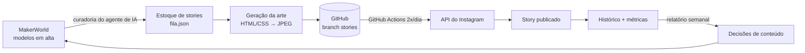

# Use Led — automações com IA para um e-commerce de impressão 3D

Portfólio das automações que construí para a **Use Led**, minha loja de luminárias e peças em impressão 3D ([@useledluminarias](https://www.instagram.com/useledluminarias/)). Uso o **Claude como agente de IA** para fazer curadoria de conteúdo, escrever código, criar artes e organizar a operação. A execução fica no **GitHub Actions**, sem depender de computador ligado.

> Desde 22/10/2026 a automação publicou **30 stories** sem intervenção manual (2 por dia, às 9h e às 20h).

## O que está automatizado

| Automação | O que faz | Onde roda | Frequência |
|---|---|---|---|
| **Curadoria de stories** | O agente de IA busca modelos 3D em alta no MakerWorld, filtra por tema sazonal, licença e complexidade de impressão, escolhe a foto mais limpa e monta um estoque de stories | Claude (agente) + navegador | 2x por semana |
| **Geração de artes** | Template HTML/CSS da marca renderizado em JPEG 1080x1920 | Python + Playwright | a cada story |
| **Publicação de stories** | Publica o próximo item da fila pela API do Instagram, com janelas de tolerância e disparos de reserva | GitHub Actions | 2 por dia |
| **Repost do feed** | Escolhe um post do último ano, gera a arte e publica nos stories | GitHub Actions | a cada 2 dias |
| **Story semanal de produto** | Rodízio dos produtos da Shopee nos stories | GitHub Actions | 1 por semana |
| **Renovação de token** | Renova o token de 60 dias da API do Instagram e atualiza o segredo no GitHub | GitHub Actions | todo domingo |
| **Relatório do Instagram** | Coleta métricas 4x por dia e gera um resumo semanal (alcance por tema, manhã × noite, melhor story) | GitHub Actions | semanal |
| **Pins do Pinterest** | Gera artes 1000x1500 e a planilha de criação em massa dos pins da Shopee; o catálogo do site sincroniza pelo app da Nuvemshop | Python + Playwright | mensal |

## Como funciona



## Como uso a IA

- **Agente de curadoria:** o Claude segue rotinas escritas em linguagem natural ([`docs/ROTINA_ESTOQUE.md`](docs/ROTINA_ESTOQUE.md), [`docs/ROTINA_STORY.md`](docs/ROTINA_STORY.md)) com regras de negócio: temas da semana, sazonalidade, sem repetir modelo por 30 dias, evitar peças muito complexas ou com conotação política.
- **Prompt engineering como especificação:** cada rotina diz o que fazer, em que ordem, o que registrar e quando parar e avisar o dono.
- **Desenvolvimento assistido por IA:** scripts Python, workflows do GitHub Actions e integração com a API da Meta construídos em parceria com o Claude.
- **Criação de conteúdo:** identidade visual da marca, artes, etiquetas de embalagem e posts gerados com IA a partir de um manual de marca.

## Decisões e aprendizados

O registro completo está em [`docs/decisoes.md`](docs/decisoes.md). Alguns destaques:

- **Atrasos do agendador do GitHub:** os disparos chegaram a atrasar de 1h30 a 4h. A solução foi ter vários disparos por período e um script que só publica dentro da janela certa e nunca duplica.
- **Proteção anti-robô do MakerWorld:** em vez de tentar burlar a proteção, a coleta roda pelo navegador, como um usuário comum.
- **Compartilhar post no story:** a API não tem compartilhamento nativo, então a automação gera uma arte da marca com a imagem do post.
- **Pinterest:** a publicação por RSS exige link do site verificado, então os pins da Shopee saem por planilha de criação em massa.

## Estrutura

```
docs/         rotinas do agente, planejamento e registro de decisões
stories/      curadoria (escolha de tema), arte, publicação e histórico
pinterest/    gerador de pins e planilha de criação em massa
instagram/    coleta de métricas e relatório semanal
```

O publicador em produção, com os workflows, fica no repositório público [**useled-stories-midia**](https://github.com/Elielsonbo/useled-stories-midia).

## Stack

Python · GitHub Actions · Playwright · API do Instagram (Meta Graph) · Claude (agente de IA) · HTML/CSS · Nuvemshop · Shopee · Pinterest

## Segurança

Tokens, base de custos e dados de clientes não ficam neste repositório. Os segredos ficam em *GitHub Secrets* e em arquivos locais listados no `.gitignore`.

---

**Elielson Oliveira** · Estudante de Engenharia Elétrica (UFOP) · elielsonbo2@gmail.com
